<!-- Words, art and layout by @lechakrawarthy · CC BY-NC-SA 4.0, see LICENSE · art is generated by tools/render.py -->

&nbsp;
&nbsp;
&nbsp;

  

 

 

 

 

  

  

<b>If you've read this far, let's build something that matters.</b> 
<i>"After all this time?" "Always."</i>

