<!-- Words, art and layout by @lechakrawarthy · CC BY-NC-SA 4.0, see LICENSE -->

<picture><source media="(prefers-color-scheme: dark)" srcset="./assets/v1/header-0-dark.svg"></picture> 
<picture><source media="(prefers-color-scheme: dark)" srcset="./assets/v1/header-1-0-dark.svg"></picture><a href="https://lechakrawarthy.tech"><picture><source media="(prefers-color-scheme: dark)" srcset="./assets/v1/header-1-1-dark.svg"></picture></a><picture><source media="(prefers-color-scheme: dark)" srcset="./assets/v1/header-1-2-dark.svg"></picture> 
<picture><source media="(prefers-color-scheme: dark)" srcset="./assets/v1/header-2-0-dark.svg"></picture><a href="https://linkedin.com/in/lechakrawarthy"><picture><source media="(prefers-color-scheme: dark)" srcset="./assets/v1/header-2-1-dark.svg"></picture></a><picture><source media="(prefers-color-scheme: dark)" srcset="./assets/v1/header-2-2-dark.svg"></picture> 
<picture><source media="(prefers-color-scheme: dark)" srcset="./assets/v1/header-3-0-dark.svg"></picture><a href="mailto:chakravarthi1597@gmail.com"><picture><source media="(prefers-color-scheme: dark)" srcset="./assets/v1/header-3-1-dark.svg"></picture></a><picture><source media="(prefers-color-scheme: dark)" srcset="./assets/v1/header-3-2-dark.svg"></picture> 
<picture><source media="(prefers-color-scheme: dark)" srcset="./assets/v1/header-4-dark.svg"></picture>

 

<picture><source media="(prefers-color-scheme: dark)" srcset="./assets/v1/numbers-0-dark.svg"></picture>

 

<picture><source media="(prefers-color-scheme: dark)" srcset="./assets/v1/body-0-dark.svg"></picture> 
<a href="https://github.com/lechakrawarthy/vazr"><picture><source media="(prefers-color-scheme: dark)" srcset="./assets/v1/body-1-0-dark.svg"></picture></a><picture><source media="(prefers-color-scheme: dark)" srcset="./assets/v1/body-1-1-dark.svg"></picture> 
<a href="https://twinance.vercel.app"><picture><source media="(prefers-color-scheme: dark)" srcset="./assets/v1/body-2-0-dark.svg"></picture></a><picture><source media="(prefers-color-scheme: dark)" srcset="./assets/v1/body-2-1-dark.svg"></picture> 
<a href="https://admesh.co"><picture><source media="(prefers-color-scheme: dark)" srcset="./assets/v1/body-3-0-dark.svg"></picture></a><picture><source media="(prefers-color-scheme: dark)" srcset="./assets/v1/body-3-1-dark.svg"></picture> 
<a href="https://sihsupport.vercel.app"><picture><source media="(prefers-color-scheme: dark)" srcset="./assets/v1/body-4-0-dark.svg"></picture></a><picture><source media="(prefers-color-scheme: dark)" srcset="./assets/v1/body-4-1-dark.svg"></picture> 
<picture><source media="(prefers-color-scheme: dark)" srcset="./assets/v1/body-5-0-dark.svg"></picture><picture><source media="(prefers-color-scheme: dark)" srcset="./assets/v1/body-5-1-dark.svg"></picture>

 

<picture><source media="(prefers-color-scheme: dark)" srcset="./assets/v1/activity-0-dark.svg"></picture>

 

<picture><source media="(prefers-color-scheme: dark)" srcset="./assets/v1/footer-0-dark.svg"></picture>

